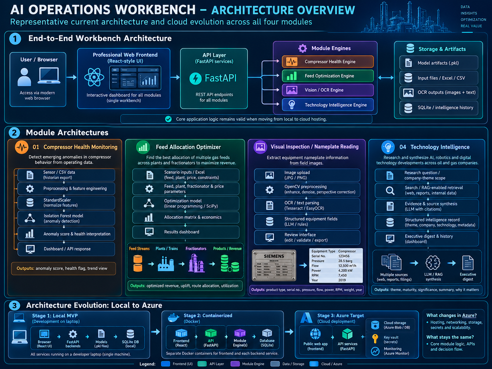

# AI Operations Workbench

**End-to-end industrial AI portfolio integrating predictive analytics, optimization, computer vision and GenAI/search-enabled intelligence workflows.**

This project was built as a hands-on learning and portfolio exercise to understand the full AI application lifecycle — from data preparation and modeling to API integration, frontend design, application architecture and cloud-ready deployment design.

> **Portfolio scope:** The operating data, economics and validation cases used here are synthetic or illustrative. This repository demonstrates engineering workflow and architecture, not field-validated production performance or realized business value.

---

## Why I built this

My objective was to move beyond isolated notebooks and understand how different AI capabilities come together in one application.

The Workbench combines four different AI/analytics patterns:

1. **Predictive analytics** — compressor health monitoring
2. **Optimization** — gas feed allocation
3. **Computer vision** — equipment nameplate OCR
4. **GenAI / technology intelligence** — evidence-backed research workflow

The focus was not just the models themselves, but the full chain:

```text
Business problem
    ↓
Data / inputs
    ↓
Model / optimization / OCR / LLM workflow
    ↓
FastAPI service
    ↓
React application
    ↓
Decision output
    ↓
Cloud-ready deployment architecture
```

---

## Workbench overview

| Module | Business question | Core technology | Main output |
|---|---|---|---|
| **Compressor Health** | Is the compressor operating abnormally compared with its learned normal baseline? | Isolation Forest, StandardScaler, FastAPI | Anomaly score, health status, trend |
| **Feed Allocation Optimizer** | How should available gas feeds be routed through constrained processing assets to maximize synthetic planning value? | SciPy linear programming | Optimal route allocation, utilization, bottlenecks, economic comparison |
| **Visual Operator Rounds** | Can equipment nameplate information be extracted from field images? | OpenCV, EasyOCR, Pillow | OCR text and structured asset information |
| **Technology Intelligence** | What recent AI / digital / robotics developments are materially relevant to an oil & gas operator? | Search-enabled LLM workflow, FastAPI, SQLite | Evidence-backed research brief, sources, research history |

---

## Application architecture



### Current application structure

```text
User / Browser
      ↓
React Frontend
      ↓
FastAPI APIs
      ├── Compressor Health
      ├── Feed Optimizer
      ├── Visual Inspection
      └── Technology Intelligence
      ↓
Python engines
      ├── Isolation Forest
      ├── SciPy optimization
      ├── OpenCV + EasyOCR
      └── Search-enabled LLM workflow
```

### Deployment evolution

```text
Notebook experiments
      ↓
Reusable Python logic
      ↓
FastAPI services
      ↓
Integrated React application
      ↓
Docker / cloud-ready packaging
      ↓
Target public cloud deployment
```

The repository contains Dockerfiles and Azure-readiness configuration. The current portfolio should be described as **cloud-ready / deployment-designed**, not as a production Azure deployment unless a live cloud deployment is completed.

---

# Module 1 — Compressor Health Monitoring

### Problem

Industrial compressors generate large volumes of operating data, but abnormal behavior can emerge gradually across multiple variables.

### Approach

A synthetic six-month compressor dataset is used to demonstrate an unsupervised anomaly-detection workflow.

The pipeline includes:

```text
Raw compressor data
      ↓
Feature preparation
      ↓
StandardScaler
      ↓
Isolation Forest
      ↓
Anomaly score
      ↓
Rolling health signal
      ↓
Normal / Attention / High
```

### Implementation

- Synthetic hourly compressor dataset
- Training baseline separated from later test period
- `StandardScaler` fitted on training data
- `IsolationForest` used for anomaly scoring
- Persisted model and scaler artifacts
- FastAPI endpoint for inference
- React interface for upload, health status and trend visualization

### Important limitation

The model identifies **unusual operating patterns**. It does not diagnose a specific failure mode, predict remaining useful life, or replace engineering review.

---

# Module 2 — Gas Feed Allocation Optimizer

### Problem

Multiple gas feeds may differ in availability and composition while plants and fractionators have finite capacities and route restrictions.

The planning question becomes:

> How much of each feed should be allocated through each feasible processing route?

### Approach

The problem is formulated as a linear optimization model.

```text
Feed availability + composition
             ↓
Plant / fractionator constraints
             ↓
Route permissions + product values
             ↓
Linear programming solver
             ↓
Optimal feed → plant → fractionator allocation
```

### Implementation

- 8 synthetic feed streams
- 5 processing plants
- 3 fractionators
- Feed composition and availability
- Plant and fractionator capacities
- Component recovery assumptions
- Product planning prices
- Route restrictions
- SciPy `linprog`
- FastAPI service
- Editable React scenario interface
- Excel upload option

### Demonstration economics

The bundled synthetic case produces an illustrative uplift of approximately:

- Baseline: **$1.87M/day**
- Optimized: **$1.95M/day**
- Difference: **~$77.6k/day**
- Improvement: **~4.15%**

These values are **synthetic demonstration outputs**, not realized savings.

---

# Module 3 — Visual Operator Rounds

### Problem

Field equipment information is frequently captured manually from nameplates, introducing transcription effort and making information difficult to digitize.

### Approach

```text
Equipment image
      ↓
Image preprocessing
      ↓
OCR
      ↓
Recognized text
      ↓
Structured asset record
```

### Implementation

- JPG / PNG upload
- Pillow image handling
- OpenCV preprocessing
- EasyOCR text detection and recognition
- FastAPI endpoint
- React upload / preview workflow

### Current capability

The MVP works best with:

- clear printed text
- straight-on images
- adequate lighting
- reasonable image resolution

Low-contrast, embossed, corroded or highly angled nameplates remain challenging.

---

# Module 4 — Technology Intelligence

### Problem

AI, robotics, digital twin and autonomous-operations developments are scattered across company announcements, vendor material and industry media.

A simple keyword scraper creates too much noise.

### Architecture decision

The module therefore evolves from primitive homepage scraping toward a search-enabled research workflow:

```text
Research question
      ↓
Search / retrieval
      ↓
Source discipline
      ↓
Evidence synthesis
      ↓
Structured brief
      ↓
Research history
      ↓
Future trend / novelty comparison
```

### Implementation

- Natural-language research question
- Search-enabled OpenAI Responses API design
- Preference for first-party and credible sources
- Evidence-backed synthesis
- Source extraction
- SQLite research history
- FastAPI endpoints
- React research interface

### Important limitation

Live research requires a valid API key with available OpenAI API credits. The code is present in the portfolio, but live research should not be claimed as operational unless the API is funded and configured.

---

## Technology stack

### Frontend
- React
- Vite
- Recharts
- Lucide React
- CSS

### Backend
- Python
- FastAPI
- Uvicorn

### AI / analytics
- scikit-learn
- Isolation Forest
- StandardScaler
- SciPy optimization
- OpenCV
- EasyOCR
- OpenAI Responses API design

### Data / persistence
- CSV
- Excel
- JSON
- serialized model artifacts
- SQLite

### Architecture / deployment
- REST APIs
- Dockerfiles
- GitHub
- Azure-ready configuration
- environment-based API routing

---

## Repository structure

```text
AI-Operations-Workbench/
│
├── professional_web/
│   ├── src/
│   ├── public/
│   └── package.json
│
├── Compressor Health Module/
│   ├── app.py
│   ├── compressor.ipynb
│   ├── model artifacts
│   └── Dockerfile
│
├── Feed Allocation Optimizer/
│   ├── app.py
│   ├── optimizer.py
│   ├── input workbook
│   └── Dockerfile
│
├── Computer Vision/
│   ├── app.py
│   ├── vision_engine.py
│   ├── test_images/
│   └── Dockerfile
│
├── Market Intelligence/
│   ├── app.py
│   ├── research_api.py
│   ├── collector.py
│   └── Dockerfile
│
├── docs/
│   ├── PROJECT_STORY.md
│   └── SCREENSHOT_GUIDE.md
│
└── README.md
```

---

## What this project demonstrates

This Workbench is intended to demonstrate that I can connect business problems with AI application design across multiple technology types.

It covers:

- problem formulation
- synthetic data preparation
- feature engineering
- model training and evaluation
- optimization formulation
- computer-vision preprocessing
- OCR
- GenAI/search workflow design
- API development
- model serving
- frontend integration
- application architecture
- deployment packaging
- cloud-readiness planning
- technical limitations and validation boundaries

---

## Project evolution

The project deliberately evolved through multiple implementation stages:

```text
Jupyter notebooks
      ↓
Standalone Python scripts
      ↓
FastAPI backends
      ↓
Streamlit prototypes
      ↓
Professional React frontend
      ↓
Modular Workbench
      ↓
Docker / Azure-ready architecture
```

This evolution was an important part of the learning objective: understanding not just how a model works, but how an AI capability becomes an application.

---

## Portfolio statement

A precise way to describe the project today is:

> **Designed and developed an end-to-end AI Operations Workbench integrating predictive analytics, optimization, computer vision and GenAI/search-enabled workflows, covering data preparation, model development, API integration, application architecture and cloud-ready deployment design.**

After an actual public-cloud deployment is completed, the final phrase can be changed from **“cloud-ready deployment design”** to **“cloud deployment.”**

---

## Screenshots

The recommended screenshot sequence is documented in:

**[`docs/SCREENSHOT_GUIDE.md`](docs/SCREENSHOT_GUIDE.md)**

Suggested final README image order:

1. Workbench Overview
2. Compressor Health result
3. Feed Optimizer scenario + result
4. Visual Inspection OCR result
5. Technology Intelligence research screen
6. Architecture overview

---

## What I would improve next

For a production-grade implementation, the next steps would include:

- historian / operational data integration
- production data validation
- model registry and drift monitoring
- optimization with additional nonlinear process constraints
- OCR confidence scoring and asset-master matching
- managed database instead of local SQLite
- authentication and role-based access
- API gateway / private networking
- centralized logging and monitoring
- CI/CD
- fully deployed public-cloud environment

---

## Disclaimer

This repository is a portfolio and learning project. It uses synthetic or illustrative data and does not represent proprietary ADNOC operating data, field-validated models, or realized company financial value.
